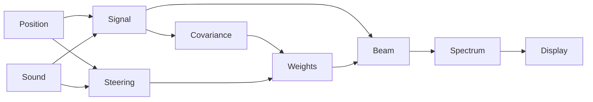

# Nodeを使ったビーム形成データフロー

`pipeline.py`は、既存フローをNodeによる配信・購読へ書き換えた実行例です。
表示用の計算をSpectrum段へ分離し、Displayは表示用Stateを周期的に参照します。
通信・予約・commit・sendにはSigBusを使い、数値処理はスタブです。
各Moduleを別Stageに置き、既存Workerで並行実行します。
AP側に残った負担と理由は[AP_NOTES.md](AP_NOTES.md)に記録しています。

## 実行

リポジトリ直下で実行します。

```sh
.venv/bin/python -m examples.beamforming.pipeline --quiet
.venv/bin/python -m examples.beamforming.pipeline --transport file --display latest
.venv/bin/python -m examples.beamforming.pipeline --transport shared_memory --frequencies 8 --frequencies-per-tick 2 --quiet
.venv/bin/python -m pytest examples/beamforming -q
```

SigBus本体のインストールだけでWorkerとModuleも利用できます。`--quiet`なしではスペクトル相当の数値も表示します。
最後のJSONにはcommit件数、受信番号、状態世代、平均窓、IDLE回数、処理エラー件数を出します。
`published`の値は処理ごとにcommit後に加算し、正常終了時には全sendの完了も確認済みです。
従来の`unavailable_retries`は削除しました。領域不足・入力不足の待機はNode内部で行います。

## データフローの接続



| Module | 出力 | 実行内容 |
|---|---|---|
| Position | State、1 slot、channels×3 | 位置を一度公開 |
| Sound | State、2 slots、scalar | 既定20 Hzで音速を更新 |
| Steering | State、2 slots、directions×channels | 既定20 Hzで位置と音速の現在値から計算 |
| Signal | FIFO、5 slots、samples×channels | 既定200 Hzで位置と現在の音速を使い、24ブロック生成 |
| Covariance | State、2 slots、channels×channels | 全信号を順に消費し、AP内の指数移動平均を更新 |
| Weights | State、3 slots、frequencies×directions×channels | 既定100 Hzで2周波数ずつ計算し、全8周波数の完成時にcommit |
| Beam | FIFO、5 slots、samples×directions | 独立したSubscriberで全信号を読み、重みを適用 |
| Spectrum | State、2 slots、samples＋power | 全BeamをFIFOで受け取り、平均窓または末尾サンプルのパワーを公開 |
| Display | 端末出力 | 表示周期ごとにSpectrumの現在値を参照。同じ値でも再表示 |

`Pipeline.specs`がデータの形状・容量、`Pipeline`のStage一覧が駆動周期を定義します。
`slots=5`は容量であり、5件を待つバッチ設定ではありません。全Streamの`batch_size`は1です。
Stateの途中更新は飛ばせます。各入力のtimestampやgenerationを一致させる処理は行いません。
Stateで読む値は予約成立時の値であり、その後の計算までの更新を反映し直すものではありません。

## 通常のパイプライン：一式をNodeへ登録

Covariance／Beamなどは、必要な入出力を1つのNodeに登録します。
ライブラリの`Module.make_node()`が登録と停止情報の接続をまとめます。APのwithは残します。

```python
from sigbus import Node

node = Node()
node.add_subscriber(signal)
node.add_subscriber(weights)
node.add_publisher(output)

with node.acquire(stop_event=stop_event) as frames:
    frames[output].payload[...] = beam_stub(
        frames[signal].payload, frames[weights].payload)
# 一式をcommitし、入力を返却。sendはSigBus内部で進行。
```

APが「出力→状態→FIFO」の取得順を組み立てたり、空き不足で処理を呼び直したりするコードはなくしました。
通常の`acquire()`にはtimeoutを指定せず、予約が揃うまで待ちます。
Spectrumは1ブロックから0個以上の平均窓を生成するため、同じNodeで購読側・配信側を別々に手動取得します。
Workerの各Stageが別スレッドなので、待機中も他段が進みます。
出力のみのPosition／Soundと、生成番号をtimestampにするSignalはtimestampを明示します。
Covariance／Beamは最初に登録した信号Subscriberのtimestampを継承します。

Signal／BeamのPublisherは`FIFOPolicy(overflow="block", no_readers="proceed")`です。
FIFO読者の未読は保持し、容量不足なら待ちます。Beamの読者はSpectrumです。
表示の遅さによってFIFOの読み出しが遅れる構成にはしていません。
Workerが全Moduleをinitializeしてから駆動するため、信号生成前に両FIFO読者を登録できます。

## 周期的な現在値参照

Steering／Weightsも、入力と出力を1つのNodeへ登録します。更新有無の検出はしません。
Steeringは1周期で完結するwith形式、Weightsは入力の現在値を計算開始時に取得して複数周期保持する手動形式です。

```python
with self.node.acquire() as frames:
    sound, position = frames[self.sound], frames[self.position]
    frames[self.out].payload[...] = steering_stub(position.payload, sound.payload)
```

入力用・出力用Nodeへの分割は不要です。同じ入力値でも周期ごとに計算できます。
音速の変更検出による公開抑制も行いません。表示も毎周期の現在値参照です。
世代番号の記録は結果確認のためだけで、実行を制御しません。

## 複数周期で完成させる処理

実際の全周波数計算などでは、APが領域を保持し、完成したときだけcommitできます。
以下は手動APIを使う形です。完成判定と計算の進捗はAPが持ちます。

```python
# 計算を開始する周期
self.node.reserve("subscribe")
self.inputs = self.node.checkout()
self.node.reserve("publish", timestamp=self.inputs[self.covariance].timestamp)
self.outputs = self.node.checkout()

# 各周期で一部を計算する。未確定出力は下流から見えない。
calculate_part(self.inputs, self.outputs)

# 全体が完成した周期
self.node.commit()
self.node.complete()
# 中止する場合はself.node.abort()
```

入力も保持して同じ条件で計算します。APにコピーする方式なら、コピー後にcompleteできます。
Node未使用でもendpoint.reserve/checkout/commit/complete/abortという同じ操作が使えます。
実行例のWeightsでこの方式を使用しています。既定は8周波数を2周波数ずつ処理する4周期の計算です。
`--frequencies`と`--frequencies-per-tick`で変更できます。最終周期が端数でも全周波数を書き終えてからcommitします。
計算中は入力2つと出力slotを保持します。新しい入力が公開されても進行中の計算条件は変えません。
途中のProcessingErrorは出力全体を固定値0に置き換えてcommitし、停止時にはModuleがabortします。
完成済みの前回値は計算中も下流から取得できます。

`weights_calculation_passes`に完成した計算ごとの周期数・入力世代・代替値使用の有無を記録します。
その他の1周期で完結する段はwith形式を維持します。数値処理の簡略化とslot設定の理由はAP_NOTESを参照してください。

## 処理エラーと公開エラー

数値処理は`position_stub`、`sound_stub`、`steering_stub`、`signal_stub`、
`covariance_stub`、`weights_stub`、`beam_stub`に分けています。実際のDSP処理へ差し替える箇所です。

共通の`calculate()`は、想定した処理失敗である`ProcessingError`を捕捉します。

- Covariance：APが保持した前回の共分散値を公開する。
- その他：固定値0を出力全体に設定する。
- 代替値も通常データとしてcommitする。処理エラー件数はAPの集計であり、diagではない。
- その他の予期しない例外はWorkerへ伝え、全段を協調停止する。
- 公開の一時的なI/OエラーはNodeのsenderが同じ出力を保持してリトライする。

前回値として保持する共分散は計算結果の独立した配列です。借用終了後のpayloadビューを保存しません。
Spectrumの平均器も、入力ビューではなく加算結果だけを保持します。
既定では8サンプルのFrameを20サンプルの窓へ集約し、最後の端数は実サンプル数で平均します。

## 終了と後始末

有限実行のため、信号のブロック数と段間の完了フラグを使います。
`finish()`はNodeのsendが完了するまで待ち、それから完了フラグを設定します。
commit直後にフラグを立てて、下流が未送信の最終データを読み落とすことを防ぎます。
Spectrumが全Beamを読み切り、平均の端数も公開します。Displayはその後の周期で最終Stateを表示して終了します。
この完了フラグは有限デモを終えるためだけのもので、描画を起動するイベントではありません。

例のModuleはライブラリの`Module`を継承します。Workerが停止Eventを基底クラスへ接続し、
ModuleがNodeと単独endpointの手動待機へ伝えます。APの例外伝播ラッパーや短いtimeoutのループは不要です。
`finish()`は停止可能なdrainを1回呼びます。確定済みのバッチ端数もflushされます。

Workerが全Stageの実行を終えた後、Moduleが未確定作業をabortし、
正常時には送信完了を待ってNodeを閉じ、停止時には未送信分を明示的に破棄します。
Nodeが所有するendpoint資源もそこで閉じます。未登録endpointの後始末もModuleが担当します。
File／SharedMemoryは専用の一時領域を使い、forceなしでremoveして資源の残りも確認します。
任意の計算や実行中のOS I/Oを強制中断するものではありません。

## 検証範囲

テストでは3 Transport × 2表示モード、遅い表示でも全処理サンプルを集計すること、平均窓の端数、入力更新中の複数周期計算と完成前の非公開、
予期しない例外・期限切れの後始末に加え、固定値／前回値での継続と公開リトライ時の計算回数を確認します。
実MVDRの正しさ、リアルタイム性能、GUI、フロー全体の別プロセス分割は対象外です。
共有メモリを選択しても、この例は同一プロセス内のStageスレッドとNodeのsenderスレッドで動作します。


## 表示データはStreamではなくState

表示処理に未読の消費や値の更新検出を要求しません。`--display average`／`latest`は
Spectrumで生成する値の種類を選び、Displayはどちらも同じ周期参照を行います。

```python
with self.node.acquire() as frames:
    spectrum = frames[self.spectrum]
    power = spectrum.payload['power'].copy()
# この周期のpowerを描画。前回から変わっていなくてもよい。
```

平均計算は全サンプルを必要とするので、SpectrumまではFIFOを使います。
計算済みの平均値を表示がすべて描画する必要はなく、遅い表示は途中の公開を飛ばせます。
表示周期が速ければ、同じtimestampの状態を繰り返し取得・描画します。
初期値の公開前だけはNodeの取得が待機します。`has_frame()`による描画判定はありません。

結果JSONの`windows`はSpectrumが計算した全窓、`displayed_windows`は実際に表示した値です。
`received.spectrum`は全Beamの受信番号、`received.display`は描画したStateのtimestampで、後者は重複・飛びを許します。

Spec一覧と各Module内の名前による接続、APに見える`with node.acquire()`は維持しています。
Module基底クラスによる取得の隠蔽やbindingsは導入していません。
